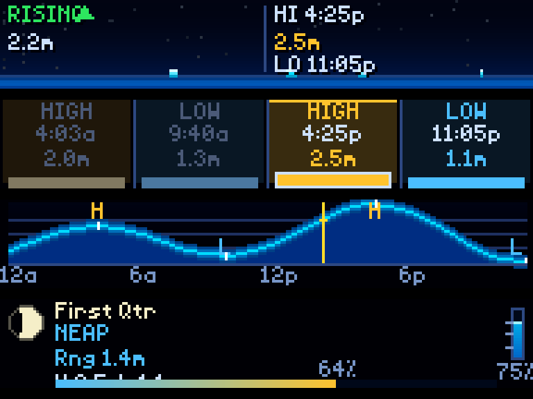

# Tides (Queensland)

Tide times for a Queensland beach on your LED matrix. It's set up for
**Woodgate Beach**. Four screens rotate on their own:

- an animated water level with the next tides;
- today's highs and lows;
- a 24-hour curve;
- the moon phase and the day's range.



This is ChuckBuilds' [Tide Display](https://github.com/ChuckBuilds/ledmatrix-plugins/tree/main/plugins/tide-display)
(1.3.5), with NOAA's US-only data replaced by Maritime Safety Queensland's
official tide predictions.

## Install

1. In the LEDMatrix web interface, open **Plugin Manager**.
2. Under **Install from GitHub**, choose **Install Single Plugin** and paste
   `https://github.com/StevenFay/ledmatrix-tides`.
3. Accept the unverified-plugin warning, then restart the display.

It works without any settings: Woodgate Beach, in metres.

## Where the data comes from

Maritime Safety Queensland publishes a year of predicted high and low waters
for each of its tide gauges on
[data.qld.gov.au](https://www.data.qld.gov.au/). Times are AEST and heights
are metres above Lowest Astronomical Tide, the same figures as the official
Queensland tide tables.

- **Downloaded once a year:** the plugin downloads a year's file the first
  time it needs it and keeps it in `data/`, so after that it runs without the
  internet. Burnett Heads 2026 comes with the plugin.
- **The next year:** 2027 is fetched when the board first needs January
  tides. If it isn't published yet, the plugin tries again every hour.
- **Between highs and lows:** the water follows a half-cosine curve, the
  usual way to fill in a tide from its turning points. This gives the
  current level, the rising or falling arrow and the chart.

### Woodgate Beach

Woodgate has no gauge of its own. The nearest is **Burnett Heads**, about
40 km north, and that's the default. Windfinder's Woodgate table, which comes
from a station at Elliot Heads, has the same tides about 3–15 minutes
earlier and about 0.1 m lower. To match it, set:

| Setting | Value |
|---|---|
| `time_offset_minutes` | `-10` |
| `height_offset_m` | `-0.1` |

The defaults are `0` and `0`, which show Burnett Heads' official times
unchanged.

### Another beach

Set `gauge` to the gauge's dataset name on data.qld.gov.au: the part before
`-tide-gauge-predicted-high-low-data` in the dataset's address. For example:

- `burnett-heads`
- `urangan` (Hervey Bay)
- `bundaberg`
- `mooloolaba`
- `brisbane-bar`

Change `station_name` to match.

## Settings

| Setting | Default | |
|---|---|---|
| `station_name` | `Woodgate Beach` | Name on the board |
| `gauge` | `burnett-heads` | Which MSQ gauge's predictions to use |
| `time_offset_minutes` | `0` | Added to every tide time (negative is earlier) |
| `height_offset_m` | `0` | Added to every height |
| `units` | `metric` | `metric` (m) or `imperial` (ft) |
| `display_duration` | `12` | Seconds per screen |

### Choosing screens

| Option | Default | What it does |
|--------|---------|--------------|
| `show_current` | `true` | The animated water-level screen |
| `show_schedule` | `true` | Today's tide times in columns |
| `show_chart` | `true` | The 24-hour curve |
| `show_stats` | `true` | Moon phase and range |
| `show_moon_phase` | `true` | The moon icon and phase name on the stats screen |


Turning a screen off shortens the rotation rather than leaving a gap. With all
four on and the default 12 seconds each, a full cycle takes just under a
minute.

**Turning all four off shows all four.** The plugin treats an empty selection
as "no preference" rather than "show nothing", so it can never go dark by
configuration alone.

`show_moon_phase` only affects the stats screen — the rest of that screen keeps
its layout, so the phase name is replaced by space rather than everything
shifting up.

### Colours

| Option | Default | What it does |
|--------|---------|--------------|
| `tide_color` | `[0, 100, 200]` | The water fill |
| `highlight_color` | `[0, 220, 255]` | Wave crests and the chart line |

The two work together: `tide_color` is the body of the water and
`highlight_color` picks out its surface, so keeping the highlight lighter than
the fill is what makes the water read as water.

### Fonts

`customization.tide_text` (the figures) and `customization.label_text` (the
HIGH/LOW captions) each take `font`, `font_size` and `text_color`.

| Font | Kind | Notes |
|------|------|-------|
| `4x6-font.ttf` | Scalable | The default; fits the small columns well |
| `PressStart2P-Regular.ttf` | Scalable | Chunky; readable further away, at the cost of fitting less |
| `5by7.regular.ttf` | Scalable | A rounder 5×7 face |
| `5x7.bdf` | Bitmap | Crisp; drawn at its native 7px |
| `4x6.bdf` | Bitmap | Native 6px, one below the default `font_size` |

**`font_size` only affects the scalable faces.** A `.bdf` is drawn at the one
pixel size its file declares. Defaults are `font_size: 7` (the 4x6 face's
pixel grid) with
`tide_text.text_color` `[205, 225, 255]` and `label_text.text_color`
`[120, 150, 200]`.

---

## Display modes

`tides_current`, `tides_schedule`, `tides_chart` and `tides_stats`. Plugin id
`tides`, so it can be installed alongside Tide Display.

## Development

```bash
LEDMATRIX_CORE=~/LEDMatrix python3 test_qld_tides.py
```

The tests cover:

- reading the CSV;
- the curve;
- the corrections;
- the yearly download, with a fake portal;
- the plugin's day in Brisbane time.

`test/harness.json` drives LEDMatrix's safety harness
(`scripts/check_plugin.py --plugin tides`), frozen at 2pm on 20 October 2026.

## Credits and licence

- Based on ChuckBuilds'
  [Tide Display](https://github.com/ChuckBuilds/ledmatrix-plugins/tree/main/plugins/tide-display)
  and licensed, like it, under the GNU GPL v3 (see `LICENSE`).
- Tide predictions are from Maritime Safety Queensland, Queensland
  Government, via data.qld.gov.au.
- Not for navigation.
